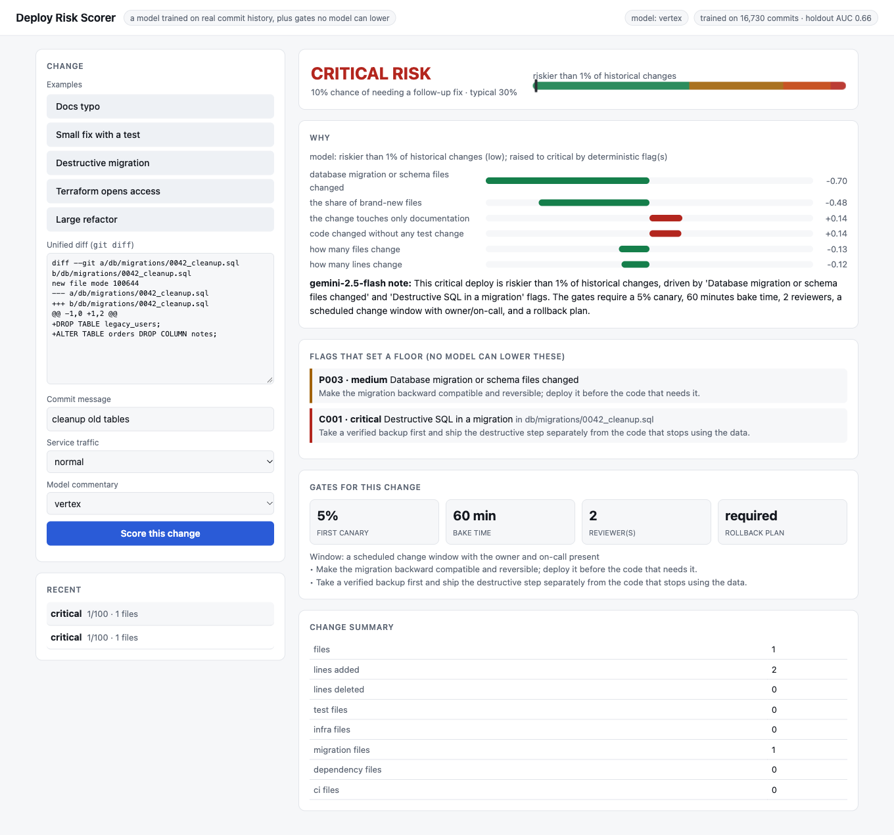
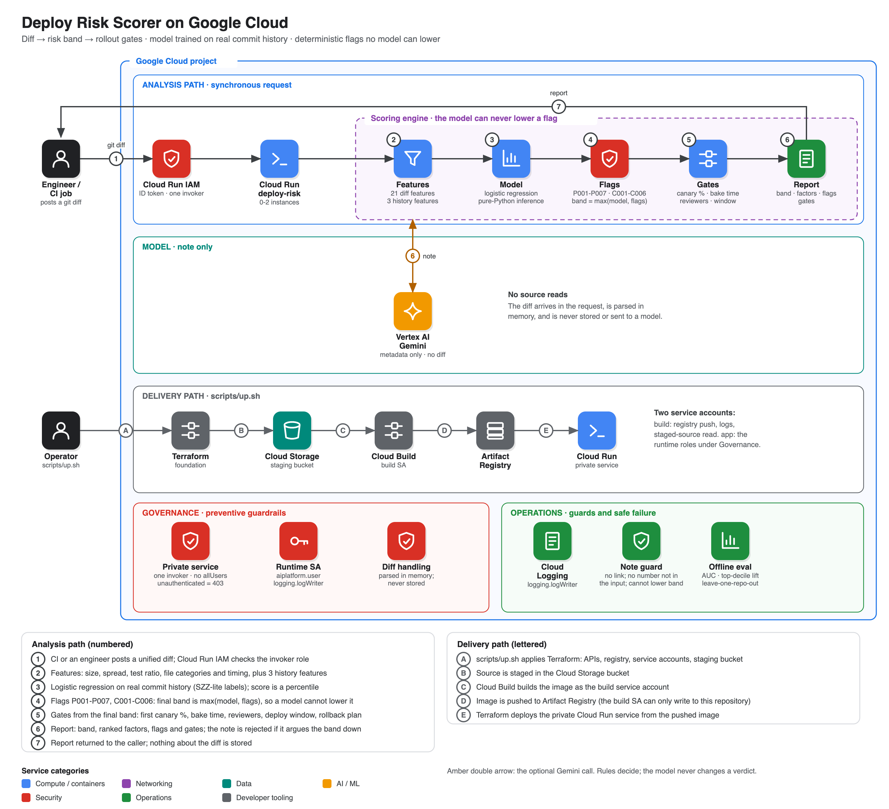

# gcp-deploy-risk-scorer

Before a change ships, how risky is it, and what should the rollout look like? This tool scores a change (a git diff, or a commit in a repo) with **a model trained on real commit history**,
adds **deterministic flags no model can lower** (destructive migrations, access widened to everyone, safety settings disabled, credentials in the diff, IAM/Terraform and CI changes), and turns
the result into **rollout gates**: first canary percentage, bake time, reviewers, deploy window, rollback plan. A model may explain the result; it never sees code or file names and cannot change the band.



## How it works

```
unified diff / git commit
   -> [features]  size, spread, test ratio, file categories (infra, IAM, migrations, deps, CI, config), deletes, binaries, message hints, time of week;
                  with a repo also: how often these files were changed and fixed before, and how familiar the author is (history only, never the future)
   -> [model]     logistic regression (pure-Python inference), probability that the change is followed by a fix or revert
                  band by rank among the 16,730 training changes: low < median, medium < p80, high < p95, critical above
   -> [flags]     path rules (Terraform deleted, IAM infra, migrations, CI, auth code without tests, very large) + content rules on ADDED lines
                  (DROP/TRUNCATE in migrations, 0.0.0.0/0 and allUsers, deletion_protection=false, keys in the diff, dependency major bumps)
   -> band = max(model band, highest flag)        -> gates for that band (+ weekend / Friday / night notes, high-traffic extension)
   -> optional model note from structured metadata (no code, no paths); rejected if it has a link, a number not in the score, or argues the band down
```

The two layers cover different failures: the model ranks ordinary changes by how they historically turned out; the flags catch the rare change that is catastrophic regardless of how small it looks
(the screenshot's two-line migration is in the 1st percentile for size and risk by history, and critical because it drops a table).

## What the model predicts (and how well)

**Label** (a proxy, not a measured incident): a commit is positive if a later commit whose message says fix/revert/hotfix/regression touches one of the same files within 30 commits and 14 days.
Trained on five public repositories (flask, requests, click, werkzeug, httpx; 16,730 labelled commits). Full tables: [docs/eval-results.md](docs/eval-results.md).

| | Diff-only (hosted service) | Full (adds repo history) |
|---|---|---|
| Chronological holdout (train on the earliest 70% of each repo, test on the latest 30%; 5,022 commits): AUC | **0.655** | **0.667** |
| Lift in the top 10% (precision vs base rate 20.8%) | 1.58x | 1.65x |
| Brier score vs predicting the base rate (0.1827) | 0.1771 | 0.1735 |
| Leave-one-repo-out AUC (repo never seen), range over 5 repos | 0.63 to 0.74 | 0.66 to 0.72 |
| Baseline: lines changed alone, same splits | 0.60 to 0.71 | |

This is real but modest skill: it beats "bigger diffs are riskier" in every split, and it is a triage signal, not an oracle. It is weakest on `requests` (AUC 0.53 in the time-ordered split for the diff-only model).
Things worth knowing about what it learned: files that were changed often before (hotspots) and files with a fix history are riskier; authors who know the files are safer; docs-only changes are safer;
a commit message that says "fix" raises the score, because in this data fixes are often followed by further fixes. Repository age was deliberately removed as a feature after it improved headline numbers but was a time-trend artifact.

## Architecture

[](docs/img/architecture.svg)

Regenerate with `python3 docs/diagrams/architecture.py` then `python3 docs/diagrams/render.py docs/img/architecture.svg docs/img/architecture.png` (needs Playwright).

## Quick start

```bash
python3 -m venv .venv && .venv/bin/pip install -e ".[dev]"
git diff main... | .venv/bin/deployrisk score --diff - --message "refactor billing"; echo "exit=$?"   # 0 low, 1 medium, 2 high, 3 critical
.venv/bin/deployrisk score --repo . --rev HEAD                          # full model: uses this repo's history
.venv/bin/deployrisk train path/to/repoA path/to/repoB                  # retrain the bundled models (needs numpy)
```

In CI: fail or require approval by exit code, and print the gates into the PR.

## Deploy to GCP

```bash
cp deploy.env.example deploy.env && ./scripts/up.sh
gcloud run services proxy deploy-risk --region us-central1 --port 8081
./scripts/down.sh
```

Terraform creates APIs, Artifact Registry, a build identity, a runtime service account (`aiplatform.user` and `logging.logWriter` only: it reads no project data) and a private Cloud Run service
(0-2 instances, one invoker, no `allUsers`). The diff arrives in the request, is parsed in memory, and is never stored or sent to a model.

Docs: [architecture](docs/architecture.md) · [threat model](docs/threat-model.md) · [runbooks](docs/runbooks/) · [ADRs](docs/adr/) · [evaluation](docs/eval-results.md)

## Verification

| Check | Result |
|---|---|
| Offline tests | 24 pass: diff parsing, features (no look-ahead), SZZ-lite labels and horizons, history features, the model (learns a signal, calibrated, numpy and pure-Python training agree), metrics, every flag, floors the model cannot lower, gates, note validation, no code or paths sent to a model, API, CLI |
| Predictive skill | see the table above: AUC 0.655 / 0.667 on a time-ordered holdout; above the lines-changed baseline in every split |
| Model-written note (mock, gemini-2.5-flash, gpt-5-nano) | the band never changed; no payload ever contained code or paths; one gemini note rejected |
| Deployed | unauthenticated = 403; `openai` = 403; a destructive migration scored critical (model: 1st percentile, raised by flags C001 and P003) |

## Limits

- The label is a proxy: "followed by a fix or revert touching the same files soon after" over-counts normal iteration and under-counts incidents that were fixed elsewhere or never. It is not a measure of outages.
- Trained on five public Python libraries. Your service, language and release process differ; retrain on your own history (`deployrisk train`) before trusting the probabilities, and check calibration on your holdout.
- Modest accuracy (AUC about 0.65 to 0.72). Use the band as a prompt for review depth, not as a verdict. The hosted diff-only model has no history features.
- The flags are pattern-based and will miss destructive changes expressed another way (an ORM migration that drops a column, a Terraform module that destroys a resource without a recognisable line); they were written from common cases, not tested on a corpus of real incidents.
- Gates are a policy table by band, not a measured reduction in incidents.
- Message-based features (fix, wip) depend on commit-message habits and are easy to game.
