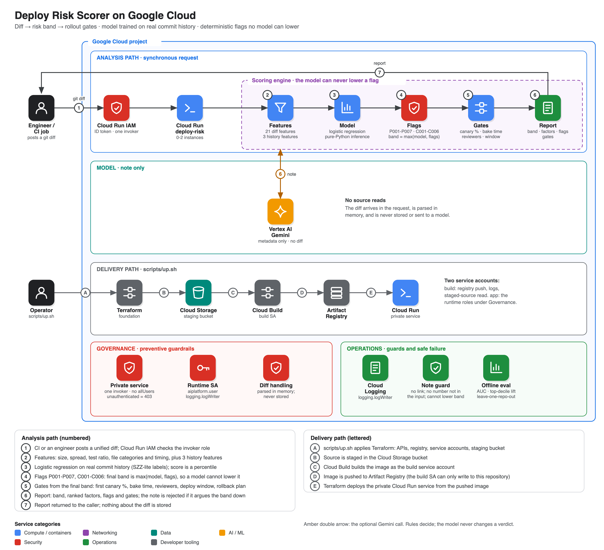

# Architecture

**Inputs.** A unified diff (`git diff`), or a commit in a local repository. The diff is reduced to per-file added/deleted counts, new/deleted/renamed/binary status, and (for content flags only) the added lines.
With a repository, history features come from `git log --numstat --summary`.

**Features** (`features.py`): 21 diff-only features (log of lines and files, directories touched, largest single-file change, test ratio, docs-only, counts of infra / IAM / migration / dependency / CI / config files,
new-file ratio, deletions, binaries, fix and wip message hints, message length, weekend / late-Friday / night) and 3 history features (log prior touches, prior fix rate, author familiarity). Generated files (lockfiles, minified, `dist/`) are ignored
for size so a huge lockfile does not dominate.

**Labels** (`history.py`): SZZ-lite. For each non-merge commit, a later commit whose message matches fix/revert/hotfix/regression and that touches one of the same files within 30 commits and 14 days makes it positive. History features use only commits
before it; the last 30 commits cannot be labelled and are dropped.

**Model** (`model.py`): logistic regression on standardised features, L2 penalty, class-weighted gradient descent, then the intercept is recalibrated so the mean prediction equals the base rate. Training uses numpy when present (fast) or a pure-Python fallback
(tested to agree); inference is pure Python so the hosted service needs no numerical library. The score is the percentile of the prediction among the training predictions.

**Evaluation** (`train.py`): chronological per-repo split (earliest 70% train, latest 30% test) and leave-one-repo-out, with AUC, lift in the top decile, Brier score against predicting the base rate, and a lines-changed-only baseline.

**Flags** (`score.py`, `signals.py`): path rules P001-P007 and content rules C001-C006. The final band is the maximum of the model band and the highest flag, so a model can never lower it. Gates come from the final band.

**Note** (`agents.py`): a model receives structured metadata only (band, probabilities, factor descriptions, flag titles, gates, counts): no diff, no file names, no commit message. The note is rejected if it has a link, a number that is not in the input, or argues the
band or gates down. A failing model removes only the note.
